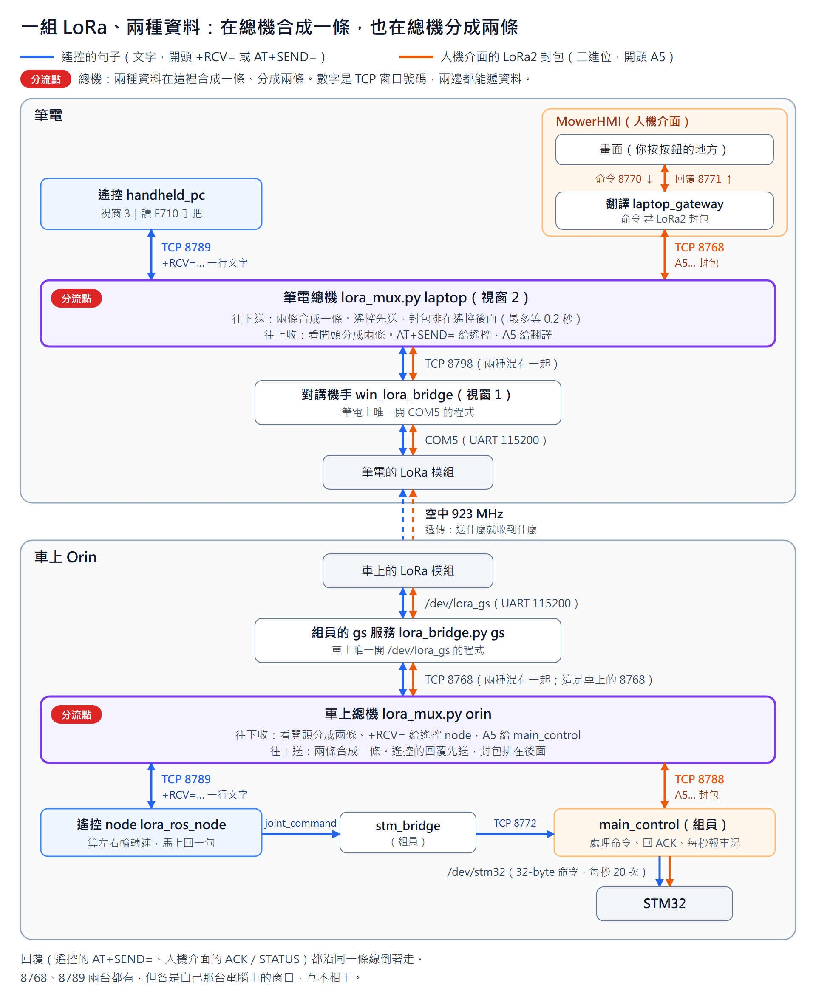

# LoRa 共用說明書

2026-11-03 ｜ 程式版本：rc_lora `25d120e`

筆電和車子之間只有**一組 LoRa**（筆電一顆、車上 Orin 一顆）。空中同時跑兩種資料：**遙控器的文字句子**（藍色）和**人機介面的 LoRa2 封包**（橘色）。兩邊各有一支「總機」程式（`lora_mux.py`），負責把兩種資料合在一起送、收到後再分開，而且**遙控永遠優先**。

現在還沒有 RP2040 遙控器，所以筆電同時扮演遙控器和人機介面。以後的樣子見第 11 節。



（圖的原始檔是 `LORA_SHARING.svg`，要改圖就改它，再轉成 PNG。）

---

## 1. 看圖之前先知道三件事

1. **數字（8770、8768、8798…）是「窗口號碼」**。每個窗口裡坐著一支程式在等（店家），另一支程式站在窗口前面（客人）。連上之後，兩邊隔著窗口互相遞資料，兩個方向都可以。
2. **`127.0.0.1` 是「這台電腦自己」**。窗口都開在自己的電腦裡，程式之間互傳，不會出網路。所以筆電的 8768 和車上的 8768 是兩台電腦上的兩個不同窗口，互不相干。
3. **有些窗口只是「問路」用**（API 窗口，`http://…`）。程式先問 API 窗口「資料窗口在哪」，回覆裡的 `data` 告訴它答案，它再去資料窗口收送資料。資料窗口的號碼永遠是 API 窗口 + 1（8767 → 8768、8787 → 8788、8797 → 8798）。圖上畫的都是資料窗口。

---

## 2. 分流點：兩個總機

整條路上，**只有兩個總機會分開或合併資料**，其他程式都是原封不動往下傳。

| 總機 | 往下（筆電 → 車上） | 往上（車上 → 筆電） |
| --- | --- | --- |
| **筆電總機**（視窗 2） | **合成一條**：8789 的遙控句子和 8768 的封包，合成一條從 8798 送下去。遙控先送，封包排在遙控後面，最多等 0.2 秒 | **分成兩條**：看開頭，`AT+SEND=` 交給 8789（遙控），`A5` 交給 8768（翻譯） |
| **車上總機** | **分成兩條**：看開頭，`+RCV=` 交給 8789（遙控 node），`A5` 交給 8788（main_control） | **合成一條**：遙控 node 的回覆和 main_control 的封包，合成一條從 8768 送上去。遙控的回覆先送 |

兩個總機中間那一段（筆電 8798 → COM5 → 空中 → /dev/lora_gs → 車上 8768）：**兩種資料混在一起走**，中間的程式和 LoRa 模組都不看內容。

總機怎麼「看開頭」：
- 遙控的句子是**文字**：開頭是 `+RCV=`（往車上）或 `AT+SEND=`（往筆電），一路到換行 `\n`，整句交給遙控那邊。
- 人機介面的封包是**二進位**：開頭是 `0xA5`，交給人機介面那邊。
- 句子掉了一半、後面直接接著封包：那半句丟掉，封包照樣交給人機介面。所以掉半句不會吃掉後面的封包。
- 往下合併時，封包一定**收齊一整個**才送，所以一個封包絕不會被遙控的句子插在中間。

---

## 3. 走一次：按人機介面的「通電」（橘色那條）

### 去程

**① 畫面 → 8770 → 翻譯**
你按下按鈕，畫面寫一張紙條 `{"command":"engine","enabled":true}`（意思是「通電」），遞進 8770 號窗口。坐在裡面的是**翻譯**（MowerHMI 裡面的 laptop_gateway）。

**② 翻譯 → 8768 → 筆電總機**
翻譯把紙條翻成車子看得懂的 16 個數字 `A5 01 02 02 06 05 34 12 0C 00 05 01 01 01 F9 BF`（每個數字的意思見 9.3），遞進 8768 號窗口。翻譯以為裡面是「LoRa 程式」，其實坐的是**筆電總機**。

**③ 筆電總機 → 8798 → 對講機手** ⬅ **合流**
總機先看遙控是不是正在講話：在講的話，就等遙控那句講完再馬上接著送，最多等 0.2 秒。然後遞進 8798 號窗口，給**對講機手**（win_lora_bridge，視窗 1）。

**④ 對講機手 → COM5 → 空中**
對講機手是筆電上唯一拿著 LoRa（COM5）的程式。它把 16 個數字原封不動丟進 LoRa，用 923 MHz 送出去。

**⑤ 車上 LoRa → /dev/lora_gs → 組員的 gs 服務**
車上 LoRa 收到後，原封不動交給組員的 gs 服務，它是車上唯一拿著 LoRa 的程式。

**⑥ gs 服務 → 車上的 8768 → 車上總機**
這是**車上電腦的** 8768，跟筆電那個是不同的窗口。這次 gs 服務坐在裡面，車上總機站在窗口前面接東西。

**⑦ 車上總機 → 8788 → main_control** ⬅ **分流**
總機看第一個數字是 `A5`，不是遙控（遙控的開頭是 `+RCV=`），所以從 8788 號窗口遞給 **main_control**。

**⑧ main_control 讀懂：「1 號車、命令、通電」**，然後做兩件事：
- 叫 STM32 通電（從 `/dev/stm32` 送 32-byte 命令）。
- 寫一張回條 ACK「第 12 號命令收到了，接受」：`A5 01 02 03 05 09 34 12 0C 00 01 00 01 73 69`。

### 回程

**⑨ 回條沿原路倒著走**：main_control → 8788 → **車上總機（合流：排在遙控 node 下一句回覆的後面）** → 車上 8768 → gs 服務 → 空中 → 對講機手 → 8798 → 筆電總機。

**⑩ 筆電總機 → 8768 → 翻譯** ⬅ **分流**：開頭是 `A5`，不是遙控的回覆（`AT+SEND=`），交給翻譯。

**⑪ 翻譯 → 8771 → 畫面**：翻譯把回條翻成 `{"type":"ack","state":"ACCEPTED"}`，從 8771 號窗口遞給畫面，畫面顯示「已接受」。

---

## 4. 走一次：把搖桿往前推一半（藍色那條）

### 去程

**① handheld_pc 讀到搖桿**
F710 往前推一半，handheld_pc 讀到 `drive = +50`（範圍 -100～+100），寫成 16 個數字 `01 11 07 00 32 00 01 00 00 00 00 00 00 00 55 BD`（`32` 就是 +50，`07 00` 表示第 7 句），再包成一行文字：
`+RCV=1,32,011107003200010000000000000055BD,0,0`

**② handheld_pc → 8789 → 筆電總機**
這次走的是 **8789**，總機專門留給遙控的窗口。

**③ 筆電總機 → 8798 → 對講機手** ⬅ **合流**
遙控的句子**不用排隊**，一收到就馬上往下送。如果有人機介面的封包在等，就排在這句後面。

**④～⑥ 跟「通電」一樣**：COM5 → 空中（大約 40 ms 到車上）→ /dev/lora_gs → gs 服務 → 車上 8768 → 車上總機。

**⑦ 車上總機 → 8789 → 遙控 node** ⬅ **分流**
總機看開頭是 `+RCV=`，知道是遙控的句子，從**車上的 8789** 遞給遙控 node（不是給 main_control 的 8788）。

**⑧ 遙控 node 算轉速**
先檢查 CRC 對不對、是不是新的一句，再算：搖桿 +50，扣掉中間 8 的死區 → 推了 46%。用 `--max-rpm 5` 的話，左右輪各 **2.28 RPM**（直直往前，所以左右一樣）。

**⑨ 遙控 node → ROS `joint_command` → stm_bridge → 8772 → main_control → STM32**
`joint_command` 不是窗口，是 ROS 的「公佈欄」：node 把轉速貼上去（換成 rad/s 是 0.239），stm_bridge 看到後換回 2.28 RPM，從 8772 交給 main_control。main_control 寫成 32-byte 命令（左右輪都寫 228，也就是 RPM × 100），每秒 20 次送給 STM32，履帶開始轉。

### 回程

**⑩ 遙控 node 馬上回一句** `AT+SEND=1,16,0191070001031495`，意思是「第 7 句收到了，目前 JOY，STM32 在 AUTO」。

**⑪ 原路倒著走**：node → 車上 8789 → **車上總機（合流：遙控的回覆先送）** → 車上 8768 → gs 服務 → 空中 → 對講機手 → 8798 → 筆電總機。

**⑫ 筆電總機 → 8789 → handheld_pc** ⬅ **分流**：開頭是 `AT+SEND=`，交給 handheld_pc。狀態沒變（還是 JOY），手把不震動。

然後 **50 ms 後再來一次**（第 8 句、第 9 句……）。放開搖桿，下一句就是 `drive = 0`，車子減速停下來。300 ms 都沒收到新的一句，node 判定失聯，自己停車。

---

## 5. 兩條路比一比

| | 按「通電」（橘） | 搖桿往前（藍） |
| --- | --- | --- |
| 誰送出 | 翻譯（MowerHMI 裡） | handheld_pc |
| 長什麼樣 | 二進位，開頭 `A5` | 文字，開頭 `+RCV=` |
| 進筆電總機的窗口 | 8768 | 8789 |
| 中間那段 | 一樣：8798 → COM5 → 空中 → /dev/lora_gs → 車上 8768 | 一樣 |
| 出車上總機的窗口 | 8788 → main_control | 8789 → 遙控 node |
| 要不要排隊 | 遙控在講話就等（最多 0.2 秒） | 不用，馬上送 |
| 多久一次 | 按一次送一次；另外每秒 1 次心跳和車況 | 每 50 ms |
| 回覆 | ACK、RESULT（回到 8768 → 翻譯 → 8771 → 畫面） | `AT+SEND=` 一句（回到 8789 → handheld_pc） |

---

## 6. 每個窗口一覽

### 6.1 筆電上

| 窗口 | 誰坐在裡面（店家） | 誰站在前面（客人） | 遞什麼 |
| --- | --- | --- | --- |
| `COM5` | win_lora_bridge（視窗 1） | —（USB 序列埠，另一頭是 LoRa 模組） | 115200 8N1。寫進去＝送上空中；讀出來＝空中收到的 |
| `http://127.0.0.1:8797` | win_lora_bridge 的 API | 筆電總機 | 只問路，回 `"data": "tcp://127.0.0.1:8798"` |
| `tcp://127.0.0.1:8798` | win_lora_bridge 的資料窗口 | 筆電總機 | 兩種混在一起 |
| `http://127.0.0.1:8767` | 筆電總機的 API，**裝成 LoRa 程式** | 翻譯 | 只問路，回 `"data": "tcp://127.0.0.1:8768"` |
| `tcp://127.0.0.1:8768` | 筆電總機的資料窗口 | 翻譯 | 只有 LoRa2 封包。翻譯 → 總機：COMMAND、HEARTBEAT；總機 → 翻譯：STATUS、ACK、RESULT |
| `tcp://127.0.0.1:8789` | 筆電總機的遙控窗口 | handheld_pc（視窗 3） | 只有遙控句子。handheld_pc → 總機：`+RCV=`；總機 → handheld_pc：`AT+SEND=` |
| `tcp://127.0.0.1:8770` | 翻譯 | 畫面 | 畫面 → 翻譯：JSON 命令 |
| `tcp://127.0.0.1:8771` | 翻譯 | 畫面 | 翻譯 → 畫面：JSON 事件（ack、result、車況） |

### 6.2 車上 Orin

| 窗口 | 誰坐在裡面（店家） | 誰站在前面（客人） | 遞什麼 |
| --- | --- | --- | --- |
| `/dev/lora_gs` | 組員的 gs 服務 | —（USB 序列埠，另一頭是 LoRa 模組） | 115200 8N1 |
| `http://127.0.0.1:8767` | gs 服務的 API | 車上總機 | 只問路，回 `"data": "tcp://127.0.0.1:8768"` |
| `tcp://127.0.0.1:8768` | gs 服務的資料窗口 | 車上總機 | 兩種混在一起 |
| `http://127.0.0.1:8787` | 車上總機的 API，**裝成 gs 服務** | main_control、傳地圖程式 | 問路，回 `"data": "tcp://127.0.0.1:8788"`；傳地圖時切模式 |
| `tcp://127.0.0.1:8788` | 車上總機的資料窗口 | main_control | 只有 LoRa2 封包。總機 → main_control：COMMAND、HEARTBEAT；main_control → 總機：STATUS、ACK、RESULT |
| `tcp://127.0.0.1:8789` | 車上總機的遙控窗口 | 遙控 node | 只有遙控句子。總機 → node：`+RCV=`；node → 總機：`AT+SEND=` |
| ROS `joint_command` 等 | （公佈欄）stm_bridge 看 | 遙控 node 貼 | 左右輪轉速、急停、解除急停 |
| `tcp://127.0.0.1:8772` | main_control | stm_bridge | 轉速和急停 → main_control；STM32 狀態 → stm_bridge |
| `/dev/stm32`（沒有就 `/dev/ttyACM0`） | main_control | —（USB 序列埠，另一頭是 STM32） | 32-byte 命令和回報，每秒 20 次 |

### 6.3 為什麼是這些號碼

- **組員定好的，我們照用**：8767／8768（組員 LoRa 程式）、8770／8771（翻譯）、8772（main_control）。人機介面和 main_control 預設都去 **8767** 找 LoRa 程式。
- **我們挑的**：8787／8788（車上總機）、8789（遙控窗口）、8797／8798（筆電上 win_lora_bridge 搬過去的位置）。挑的規則只有：
  1. 不能跟已經有人用的撞到（還有 RTK 用的 8777／8778）。
  2. 資料窗口 = API 窗口 + 1，跟組員一樣。
  3. 筆電總機**一定要坐 8767**，因為人機介面只會去 8767 找；原本的 win_lora_bridge 只好讓位到 8797。
  4. 車上的 8767 已經是 gs 服務，所以車上總機坐 8787，再用 `--bridge-api` 叫 main_control 連 8787。
- 87、97 本身沒有特別意義，換成別的沒人用的號碼也可以，兩邊對得上就好。

---

## 7. 空中跑的資料

### 7.1 無線設定（兩顆模組相同）

| 項目 | 值 |
| --- | --- |
| 頻率 | 923 MHz（`AT+BAND=923000000`） |
| 調變 `AT+PARAMETER` | `5,9,1,24`：SF5、BW 500 kHz、CR 4/5、前導 24 |
| 發射功率 | 22 dBm |
| UART | 115200 baud、8N1 |
| 模式 | 透傳：UART 進什麼，對面就吐什麼，模組不加也不拆 |

### 7.2 有哪幾種資料

| 資料 | 誰送 → 誰收 | 開頭 | 長度 | 多久一次 |
| --- | --- | --- | --- | --- |
| 遙控指令 `RC_INPUT` | handheld_pc → 遙控 node | 文字 `+RCV=` | 48 bytes | 每 50 ms（20 Hz） |
| 遙控回覆 `RC_STATUS` | 遙控 node → handheld_pc | 文字 `AT+SEND=` | 31 bytes | 每收到一句指令就回一句 |
| LoRa2 `COMMAND` | 翻譯 → main_control | `0xA5` | 15～64 bytes | 按按鈕時 |
| LoRa2 `HEARTBEAT` | 翻譯 → main_control | `0xA5` | 15 bytes | 每秒 1 次 |
| LoRa2 `STATUS` | main_control → 翻譯 | `0xA5` | 64 bytes | 每秒 1 次 |
| LoRa2 `ACK`／`RESULT` | main_control → 翻譯 | `0xA5` | 15／16 bytes | 每個命令各一次 |

遙控一來一回大約 70 ms（10/22 桌上實測：指令單向約 40 ms、回覆約 30 ms）。原本每 100 ms 一句，還剩約 30 ms 的空檔給人機介面（它的資料又小又少，每秒約 80 bytes）。11/04 起改成每 50 ms 一句（20 Hz），比一來一回還短，下一句可能跟車上的回覆撞在一起，人機介面的空檔也變小，**還在實測**。回覆率掉太多，就把 `common/rc_handheld.h` 的 `RC_HH_SEND_PERIOD_MS` 改回 `100u`。

---

## 8. 傳地圖（KCP 模式）

1. 傳地圖程式向總機的 API `POST /mode {"mode":"kcp"}`。
2. **總機先檢查遙控**：最近 3 秒內有遙控的句子 → 回 `409`「remote control has priority」，拒絕。
3. 沒有遙控 → 總機轉給組員的 LoRa 程式切到 KCP。這時資料窗口傳的是 JSON 行（`{"type":"tx","id":1,"data":"<base64>"}`），空中傳的是 KCP 封包（一個最大 240 bytes，每秒最多 4000 bytes）。
4. 傳到一半，總機只要看到遙控的句子，就**立刻中斷傳檔、切回一般模式**，LoRa 讓給遙控。
5. 傳完，傳地圖程式自己切回一般模式。

要傳地圖：先關掉 handheld_pc，等 3 秒再傳。（筆電目前的 win_lora_bridge 不支援 KCP，見第 13 節。）

---

## 9. 封包格式

三種封包的 CRC 都是 **CRC-16/CCITT-FALSE**：poly `0x1021`、init `0xFFFF`、不反射、xorout `0`，算 CRC 前面所有 bytes，**低位元組先放**。多位元組整數都是 little-endian。

### 9.1 遙控指令 `RC_INPUT`（handheld_pc → 遙控 node，16 bytes）

16 bytes 先轉成 32 個大寫十六進位字，再包成一行文字：

```text
+RCV=1,32,<32 個十六進位字>,0,0\r\n        共 48 bytes
```

`+RCV=` 是 RYLR998 收到資料時的格式。因為模組是透傳，手把直接送出車子想收到的那一行，車上的程式不用改。最後的 `0,0` 是訊號強度欄位，固定填 0。

| Byte | 欄位 | 說明 |
| --- | --- | --- |
| 0 | `version` | 固定 `0x01` |
| 1 | `type` | 固定 `0x11` |
| 2–3 | `seq` | 每送一句加 1 |
| 4 | `drive` | 左搖桿前後，-100～+100，往前為正 |
| 5 | `turn` | 右搖桿左右，-100～+100，往右為正 |
| 6 | `flags` | bit0 = 手把有資料（F710 沒斷） |
| 7 | 按鍵次數 | 低 4 bits START、高 4 bits BACK |
| 8 | 按鍵次數 | 低 4 bits X、高 4 bits Y |
| 9 | 按鍵次數 | 低 4 bits A、高 4 bits B |
| 10 | 按鍵次數 | 低 4 bits RB、高 4 bits LB |
| 11 | 按鍵次數 | 低 4 bits 十字鍵上、高 4 bits 十字鍵下 |
| 12–13 | 保留 | 填 0 |
| 14–15 | `crc` | Byte 0–13 的 CRC |

按鍵送的是「按了幾次」（0～15 循環），不是「有沒有按住」。就算掉了一句，下一句的次數一樣會變大，按鍵不會漏掉。

範例（第 4 節那句）：`01 11 07 00 32 00 01 00 00 00 00 00 00 00 55 BD`
讀法：`01` 版本、`11` 類型、`07 00` seq 7、`32` drive +50、`00` turn 0、`01` 手把正常、後面 7 個 `00` 是按鍵次數和保留、`55 BD` CRC。

### 9.2 遙控回覆 `RC_STATUS`（遙控 node → handheld_pc，8 bytes）

```text
AT+SEND=1,16,<16 個十六進位字>\r\n         共 31 bytes
```

| Byte | 欄位 | 說明 |
| --- | --- | --- |
| 0 | `version` | 固定 `0x01` |
| 1 | `type` | 固定 `0x91` |
| 2–3 | `ack_seq` | 回的是哪一句指令 |
| 4 | `indicator` | 0 ORIN、1 JOY、2 等待、3 異常／鎖定（handheld_pc 看到它變了就讓 F710 震動） |
| 5 | `state` | STM32 狀態：0 未設定、1 停止、2 MANUAL、3 AUTO、4 ESTOP、5 SBUS 測試 |
| 6–7 | `crc` | Byte 0–5 的 CRC |

範例（第 4 節的回覆）：`01 91 07 00 01 03 14 95` → `AT+SEND=1,16,0191070001031495`

### 9.3 人機介面 LoRa2 封包（翻譯 ↔ main_control，組員定義）

| Byte | 欄位 | 說明 |
| --- | --- | --- |
| 0 | 起始 | 固定 `0xA5` |
| 1 | `vehicle_id` | 車號 1～255（目前 1） |
| 2 | `version` | 固定 `0x02` |
| 3 | `frame_type` | `01` STATUS、`02` COMMAND、`03` ACK、`04` RESULT、`05` HEARTBEAT |
| 4 | `payload_length` | 0～54 |
| 5 | `seq` | 封包流水號 |
| 6–7 | `session_id` | 這次連線的編號，重連會換 |
| 8… | payload | 依 `frame_type` |
| 最後 2 | `crc` | 前面全部的 CRC |

總長 = 10 + payload 長度，最長 64 bytes。

範例（第 3 節的「通電」）：`A5 01 02 02 06 05 34 12 0C 00 05 01 01 01 F9 BF`

| Byte | 值 | 意思 |
| --- | --- | --- |
| 0 | `A5` | 起始 |
| 1 | `01` | 車號 1 |
| 2 | `02` | 版本 2 |
| 3 | `02` | COMMAND |
| 4 | `06` | payload 有 6 bytes |
| 5 | `05` | seq 5 |
| 6–7 | `34 12` | session 0x1234 |
| 8–9 | `0C 00` | command_id 12 |
| 10 | `05` | opcode：SET_ENGINE |
| 11 | `01` | 要回 RESULT |
| 12 | `01` | 參數有 1 byte |
| 13 | `01` | 參數：通電 |
| 14–15 | `F9 BF` | CRC |

回條 ACK：`A5 01 02 03 05 09 34 12 0C 00 01 00 01 73 69`。外框一樣（`03` 是 ACK，payload 5 bytes）；payload `0C 00` command 12、`01` 已接受、`00` 原因無、`01` 目前待機；最後 `73 69` 是 CRC。

各種 payload 的完整欄位見組員的《LoRa2 工作通訊規格書》v0.3（`~/fucking_mower/lora/lora2通訊規格書.md`）。

---

## 10. 時間和逾時

| 項目 | 值 | 誰負責 |
| --- | --- | --- |
| 遙控送指令 | 每 50 ms（20 Hz） | handheld_pc |
| 遙控判定失聯 | 300 ms 沒收到合法的句子 | handheld_pc 和遙控 node 都是 |
| 失聯後車子 | 送 0 轉速；恢復後搖桿要先回中才會動 | 遙控 node |
| 封包等遙控 | 最多 0.2 秒 | 總機 |
| 算「遙控正在用」 | 0.3 秒內送過句子 | 總機 |
| 遙控開著不准傳地圖 | 3 秒內收過遙控的句子 | 總機 |
| 卡住的半句／半個封包 | 0.1 秒後放棄 | 總機 |
| HEARTBEAT／STATUS | 每秒 1 次；3 秒沒心跳算失聯 | 翻譯／main_control |
| 給 STM32 的命令 | 每秒 20 次；200 ms 沒更新 STM32 會停車 | main_control |

---

## 11. 以後：RP2040 遙控器

以後還是只有一組 LoRa：**一顆在 RP2040 遙控器上、一顆在車上**。筆電沒有 LoRa，用 USB 線接遙控器，人機介面的資料借遙控器的 LoRa 送。

```text
筆電（MowerHMI） ──USB── RP2040 遙控器（F710 + LoRa） ～923 MHz～ 車上 Orin
```

圖上「筆電」那一塊的視窗 1、2、3，就是在假裝以後的 RP2040：

| 現在（筆電假裝） | 以後（RP2040 裡面） |
| --- | --- |
| 視窗 1 win_lora_bridge + 筆電的 LoRa 模組 | RP2040 上的 LoRa 模組 |
| 視窗 2 筆電總機（分流點） | RP2040 程式裡的分流，規則跟第 2 節一樣 |
| 視窗 3 handheld_pc | RP2040 讀 F710 |

- 對筆電來說，RP2040 看起來就是一顆 LoRa（一個 COM 埠）。使用者只要插上遙控器、打開 MowerHMI。
- 圖上「車上 Orin」那一塊完全不用改。
- 還要處理：人機介面開 RP2040 時不能重新設定 LoRa（要跟組員講好）；傳地圖時 RP2040 要先暫停送遙控；車上做成開機自動啟動。

---

## 12. 怎麼開、怎麼關（測試用）

### 12.1 車上（Orin）

```bash
cd ~/remote_lora/remote_orin/orin
./start_remote.sh --max-rpm 5
```

- 這一個指令會依序開好：車上總機 → main_control → stm_bridge → 遙控 node。組員的 gs 服務照常開著，不用停。
- `--max-rpm`：搖桿推到底的轉速，第一次測用 5，最大 40。
- 看到「全部開好了」就可以用。每行前面的 `[mux]`、`[main]`、`[bridge]`、`[node]` 是哪支程式印的（`mux` 就是總機）。
- **關**：按一次 Ctrl+C，等它自己全部關完。上次沒關乾淨：`./start_remote.sh --stop`。
- 不接車試試看：`./start_remote.sh --fake`（假的 STM32，碰不到正在跑的系統）。
- 假 STM32 想用組員的 `virtual_stm.py`（比較像新韌體：一開就是 AUTO 待命、輪速慢慢加上去）：`./start_remote.sh --virtual-stm`。不用自己先開它，也不用抄 `/dev/pts/N`，腳本會自己開、自己接好。
- 紀錄：`~/remote_lora/logs/<開始時間>/`，每支程式一個 `.log`。
- 這台 Orin 沒有組員的 gs 服務時，只能遙控自己用 LoRa（人機介面連不到車）：`./start_remote.sh --max-rpm 5 --lora-port /dev/lora_gs`。

### 12.2 筆電

**只用遙控**（人機介面不開）：handheld_pc 自己開 COM5，不用總機。

```
cd D:\remote_control\rc_lora\remote_orin\handheld_pc
python handheld_pc.py --port COM5
```

**遙控＋人機介面**：開 3 個命令提示字元視窗，照順序開，**人機介面最後開**。

| 視窗 | 指令 | 它坐在哪些窗口 | 它去連哪些窗口 |
| --- | --- | --- | --- |
| 1 對講機手 | `python D:\Gui_car\tools\win_lora_bridge.py --port COM5 --no-init --api-port 8797 --data-port 8798` | COM5、8797、8798 | — |
| 2 總機 | `cd D:\remote_control\rc_lora\remote_orin\common` 再 `python lora_mux.py laptop --upstream-api http://127.0.0.1:8797 --api-port 8767` | 8767、8768、8789 | 視窗 1 的 8797、8798 |
| 3 遙控 | `cd D:\remote_control\rc_lora\remote_orin\handheld_pc` 再 `python handheld_pc.py --port socket://127.0.0.1:8789` | — | 視窗 2 的 8789 |
| 最後 MowerHMI | 直接打開 | 8770、8771（翻譯） | 視窗 2 的 8767、8768 |

- **為什麼人機介面要最後開**：它打開時如果 8767 沒人，會自己去開 COM5，視窗 1 就開不了。先讓總機坐在 8767，人機介面就會連總機。
- COM5 是我們那顆 LoRa 的編號；換電腦或換 USB 孔，到裝置管理員看。
- `--no-init`：這顆 LoRa 已經設定好，不用再設定（它的 CH340 也沒接 DTR，沒辦法自動設定）。
- **關**：先關人機介面，再按 Ctrl+C 關視窗 3 → 2 → 1。

### 12.3 看總機現在的狀況

```
curl http://127.0.0.1:8787/status      ← 在車上打：問車上總機
curl http://127.0.0.1:8767/status      ← 在筆電打：問筆電總機
```

回傳裡的 `mux` 有：有沒有連上組員的 LoRa 程式、遙控是不是正在用，以及計數（遙控收發幾句、LoRa2 收發多少、傳地圖被拒絕或中斷幾次）。

---

## 13. 出問題時

| 在哪裡看到 | 看到什麼 | 原因 | 怎麼做 |
| --- | --- | --- | --- |
| Orin | 「組員的 LoRa 程式沒在跑」 | gs 服務沒開（車上 8767 沒人） | `sudo systemctl start fucking-mower-lora-gs.service`；沒有這個服務就用 `--lora-port /dev/lora_gs` |
| Orin | 「已經有程式連著組員 LoRa 的資料埠 8768」或「TCP 8772 已經有人在用」 | 組員自己的 main_control 在跑 | 先關掉它；start_remote.sh 會自己開一個 |
| Orin | 「上次沒關乾淨」 | 上次斷線或強制關掉 | `./start_remote.sh --stop` |
| Orin | 「找不到 STM32」或「STM32 … 被佔用」 | USB 沒插，或別的程式開著 STM32 | 檢查 USB；關掉畫面上列出的程式 |
| Orin | `[node]`「LoRa 讀寫失敗（分流程式關掉了？）」 | 車上總機停了（車上 8789 斷了） | Ctrl+C 全關再開；看 `mux.log` |
| 筆電視窗 3 | 「連不上 …（分流程式 lora_mux.py 有開嗎？）」 | 視窗 2 沒開（筆電 8789 沒人） | 先開視窗 1、2，再開 3 |
| 筆電視窗 1 | COM5 打不開、被佔用 | 人機介面先開了，自己拿走 COM5 | 全部關掉，照順序重開，人機介面最後開 |
| 人機介面 | 傳地圖失敗「remote control has priority … file transfer refused」 | 3 秒內有遙控的句子 | 關掉 handheld_pc，等 3 秒再傳 |
| 遙控 | 一直失聯 | 收不到回覆 | 檢查兩邊 LoRa 有沒有插好、距離、車上程式有沒有開 |

### 注意事項

- **新的 STM32 韌體不用按 R12**：程式開好、推搖桿，履帶就會動。第一次測一定先把履帶架空。
- **要馬上停就按 BACK**（ESTOP 鎖住，按 START 解除）。放開搖桿是慢慢減速（每秒少 20 RPM）。
- **筆電目前不能傳地圖**：win_lora_bridge 不支援 KCP。組員的 pc_lora_bridge 支援，但要用 DTR 重開 LoRa，我們這顆 CH340 沒接 DTR。
- **沒有組員 gs 服務的 Orin（例如 .12）不能共用**：只能用 `--lora-port`。
- **只用人機介面、不用遙控時不需要總機**：照組員原本的方式開。
